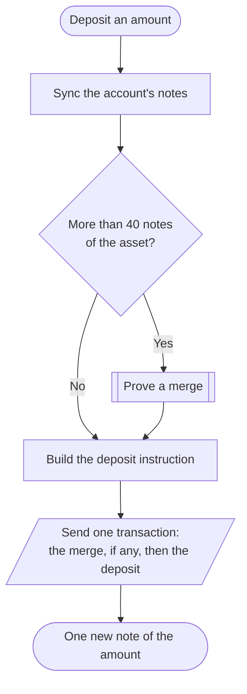
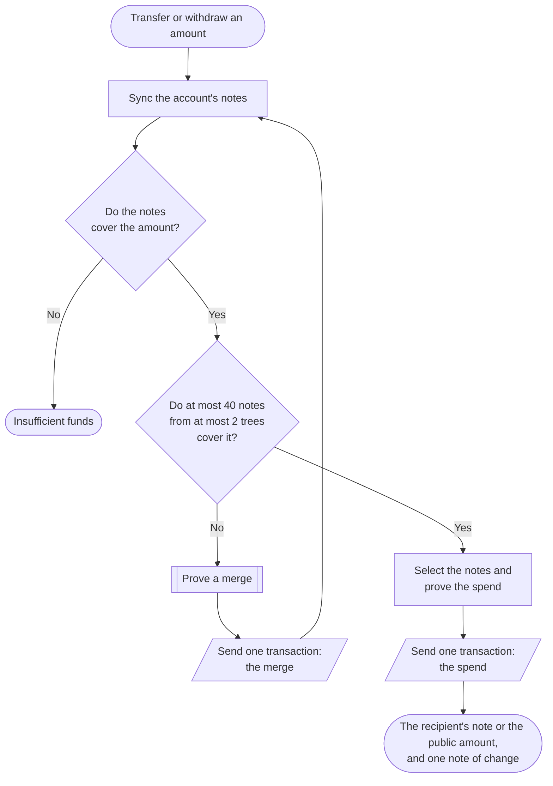

# Privacy

Solana Rings private balances: an account's registration, its received notes, deposits, and private transfers and withdrawals with their proofs. Instructions are [Transactions](../Transactions/README.md) values, and reads go through [RPC](../RPC/README.md).

## Notes

A private balance is a set of notes. A note is an unspent output (UTXO) of the pool: an amount of one asset that one account owns. The pool keeps each note's commitment in a tree and, after the note is spent, its nullifier. One transaction spends at most 40 notes from at most 2 trees.

A deposit makes one note and needs no proof.



A transfer or a withdrawal spends notes and needs a proof. Notes that one transaction can't spend are merged first.



A merge is a transfer of the notes that one transaction spends to the account itself, which leaves one note with their total.

## Usage

```swift
import Privacy
import RPC
import Transactions

let account = try ShieldedAccount(
    signingAddress: Address(address),
    nullifierSecret: keys.nullifierSecret,
    viewingKey: keys.viewingKey
)
let rpc = HeliusRPC(apiKey: apiKey, network: .mainnet)
let registration = try await account.registration(using: rpc)
let notes = try await NoteSyncState().syncedToEnd(for: account, rpc: rpc, indexer: rpc)
let spend = try await notes.spend(amount, of: .token(.usdc), to: .transfer(recipient), from: account, rpc: rpc, prover: rpc)
```

`keys` comes from Wallet's `privateBalanceKeys`.
