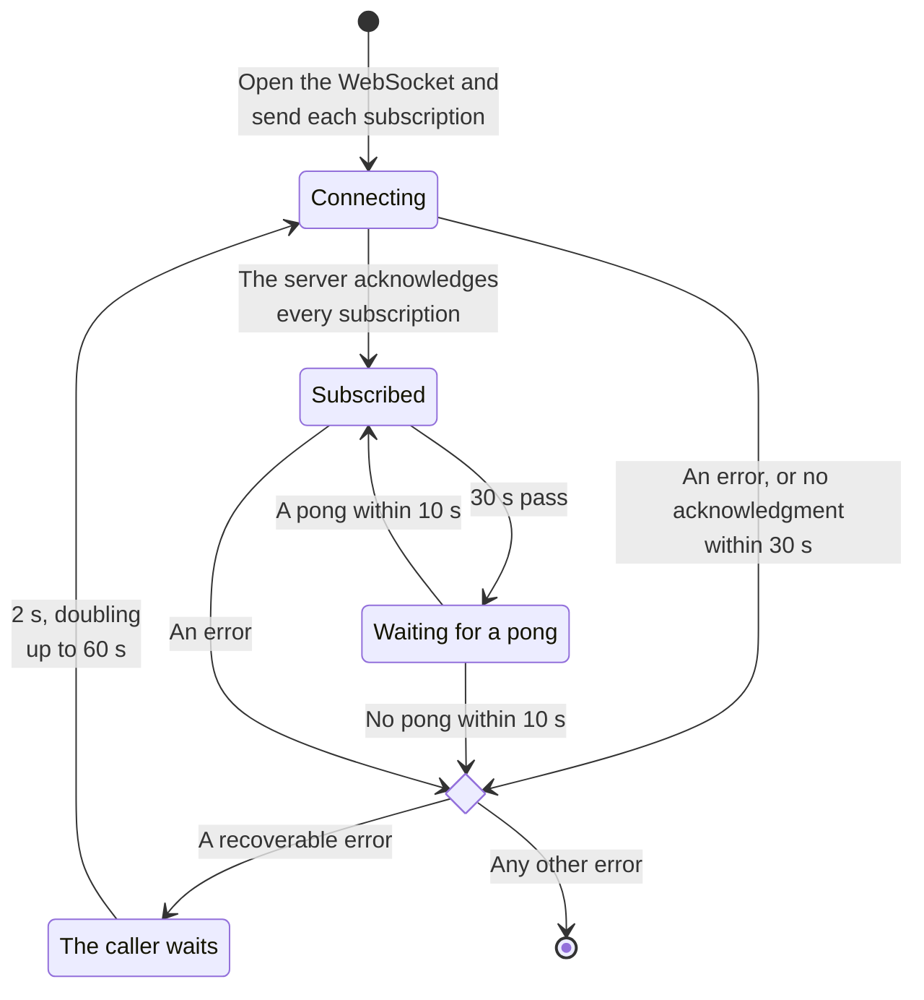

# RPC

Typed Solana RPC, DAS asset queries, prices, exchange rates, and account and signature subscriptions. Clients connect directly to providers.

## Subscription connection

Each subscription stream has its own WebSocket connection, and the stream ends with the error that closes it. The client doesn't reconnect: the caller waits with `Backoff.reconnection` and subscribes again.



## Usage

```swift
import RPC

let client: any RPC = SolanaRPC(network: .devnet)
let response = try await client.send(GetLatestBlockhash())
let blockhash = response.value.blockhash
```

## Use a custom RPC URL

`SolanaRPC(endpoint:network:)` accepts an HTTPS URL with a host and returns `nil` otherwise. The server must serve standard JSON-RPC requests at that URL, and `accountSubscribe`, `signatureSubscribe`, and `rootSubscribe` over WSS at the same URL.

```swift
let client = SolanaRPC(endpoint: URL(string: "https://rpc.example.com")!, network: .mainnet)
let prices = CustomPriceProvider(endpoint: URL(string: "https://prices.example.com")!)
```

## Add a provider

A provider is a type in this module that conforms to [`RPC`](Sources/Client/RPC.swift) and sends each `RPCRequest` to its endpoint. Wrap a `SolanaRPC` client for an endpoint that speaks standard Solana RPC, as `HeliusRPC` does. Conform to the optional capability protocols that the provider can speak, and declare in `capabilities` the ones its server serves; a feature that the provider lacks is skipped without a request.

Throw `RPCError` for failures, and send each request once: callers handle rate limits and retries.
