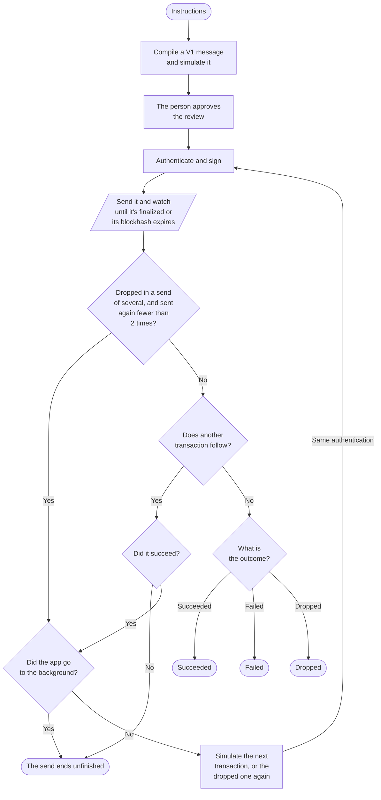

# Transactions

Builds Solana instructions, compiles them into V1 messages, decodes transactions, and assembles signatures. Token instructions support SPL Token and Token-2022. It does no networking and holds no private keys.

## Transaction workflow

One send goes from instructions to one of three outcomes. This framework compiles the message and assembles the signatures; the app does the other steps.



## Usage

```swift
import Transactions

let compiler = MessageBuilder()
let assembler = TransactionBuilder()
let transfer = try SystemProgram.transfer(from: sender, to: recipient, lamports: 1_000_000)
let message = try compiler.message(
    instructions: [transfer],
    payer: sender,
    recentBlockhash: blockhash,
    configuration: configuration
)
let unsigned = try assembler.simulationTransaction(for: message)
```
