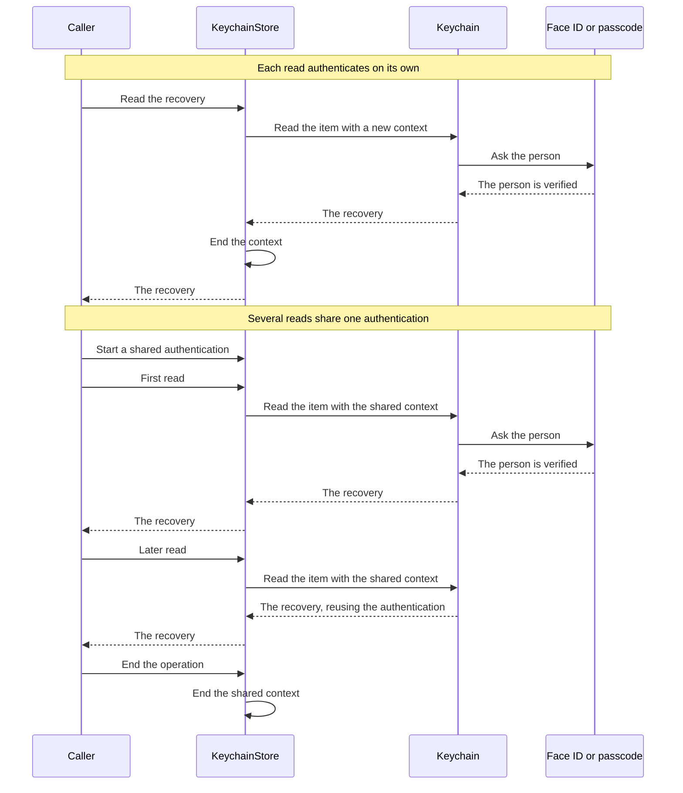

# Vault

Device-only Keychain storage for wallet recovery phrases, unlocked with biometrics or the device passcode.

## Recovery reads

Each recovery read authenticates the person on its own. Inside `withSharedAuthentication`, the first read authenticates and later reads reuse that authentication until the operation ends.



## Usage

Add `NSFaceIDUsageDescription` to the app's Info.plist.

```swift
import Vault
import Wallet

let store: any RecoveryStoring = KeychainStore(service: "com.example.wallet.recovery")
try await store.save(Recovery(phrase: phrase, passphrase: passphrase), for: recoveryID)

let restored = try await store.recovery(for: recoveryID, reason: "Unlock this wallet")
```
