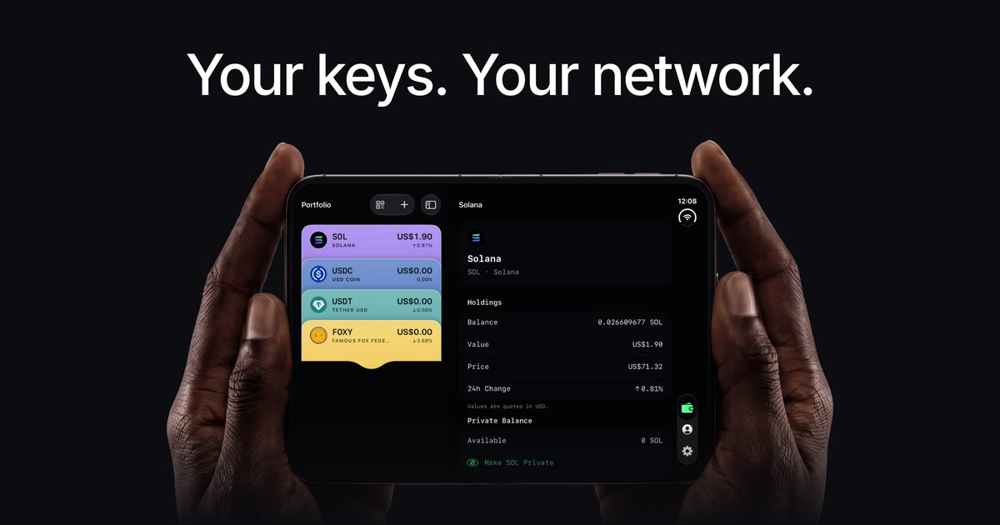

[](https://raul.xyz/wallet)

# Solana Wallet

A truly open and decentralized Solana wallet for iPhone and iPad. The app connects directly to Solana RPC providers, with no app backend or proxy. Recovery phrases and provider API keys stay on the device.

Learn more at [raul.xyz/wallet](https://raul.xyz/wallet).

## Features

- **Send and receive.** Send SOL and tokens to contacts, your own accounts, or recent recipients. The review shows the balance changes and warns about look-alike addresses, program addresses, and first payments. Receive with a QR code.
- **Your choice of RPC.** Use public Solana RPC with no key, a built-in provider with your own API key, or any HTTPS RPC URL.
- **Private balances.** Hold SOL, USDC, and USDT in a private balance, and send privately to another person's private balance.
- **No spam tokens.** Your list shows only the tokens you add, so airdropped spam never appears. SPL Token and Token-2022 both work.
- **Prices on your terms.** Use the built-in price source, your own price server, or no prices at all. Values show in the currency you pick.
- **Themes.** Choose a built-in theme, or make a theme pack with your own colors, font design, and images. See [Build a theme pack](Frameworks/Themes/README.md#build-a-theme-pack).
- **Several accounts.** One recovery phrase holds several accounts. Add, rename, and delete them in Settings.
- **Made for big screens.** Open several windows on iPad and iPhone Duo. Each window keeps its own account and its own place.

## Requirements

- Xcode 27 or later
- An iOS 27.1 or later simulator or device

## Run the app

1. Clone the repository:

   ```bash
   git clone git@github.com:raulriera/solana-wallet.git
   ```

2. Open `widgets.xcodeproj` in Xcode.
3. Choose the `widgets` scheme and an iPhone or iPad simulator.
4. Press ⌘R.

The app uses Solana's public RPC by default, so it needs no API key. To use Helius or a custom RPC URL, open Settings > RPC.

To run on a device, choose your team and a unique bundle identifier in the `widgets` target's Signing & Capabilities settings.

## Security

The app turns on Apple's [Enhanced Security](https://developer.apple.com/documentation/xcode/enabling-enhanced-security-for-your-app) protections:

- Pointer authentication and hardware-checked pointer arithmetic.
- Hardware memory tagging, a hardened heap, and read-only dyld data.
- Platform restrictions.

Recovery phrases stay in Keychain items on the device. Reading them needs Face ID, Touch ID, or the device passcode. They never sync to iCloud and are not in backups.

To report a vulnerability, see [SECURITY.md](SECURITY.md).

## Contributing

See [CONTRIBUTING.md](CONTRIBUTING.md).

## Tests

⌘U runs the Unit test plan, which never uses the network. The UI test plan uses live providers; see [UI tests](App/Tests/UI/README.md) for its setup.

## License

MIT. See [LICENSE.md](LICENSE.md).

Files copied from other projects keep their own licenses. Their license headers, or the license files next to them, name these licenses.
